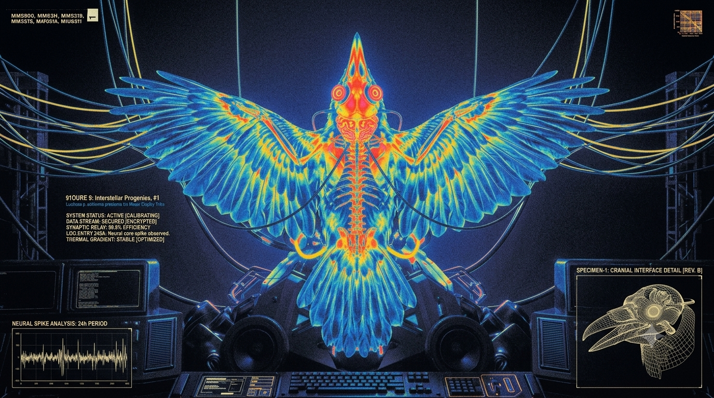

<p align="center">
  
</p>

# Stellar Raven

Stellar Raven is a remote MCP server on Cloudflare Workers exposing two tools over one catalog of
Stellar ecosystem sources: Lumenloop, Stellar Light/Scout, Stellar Docs, stellar.org, and pinned
ecosystem skills.

- `search` finds service operations and skills, and describes each source family's scope.
- `execute` runs agent-written JavaScript in a networkless Dynamic Worker isolate. Host adapters
  make all service calls and hold all secrets.

## Sources and operators

| Source family | Operator | How Raven reads it |
|---|---|---|
| Lumenloop (`lumenloop.*`) | Lumen Loop ([lumenloop.com](https://lumenloop.com/)) | API, using a key Lumen Loop issued to Raven |
| Stellar Light/Scout (`scout.*`) | Stellar Light ([stellarlight.xyz](https://stellarlight.xyz/)) | Public read-only API for AI tools and agents |
| Stellar Docs (`stellarDocs.*`) | Stellar Development Foundation ([developers.stellar.org](https://developers.stellar.org/docs)) | Official docs search and page API |
| stellar.org (`stellarOrg.*`) | Stellar Development Foundation ([stellar.org](https://stellar.org)) | Keyless site search (excluding blog, press, and events) and single-page reads |

Pinned ecosystem skills come from Lumen Loop, OpenZeppelin, the Stellar Development Foundation,
Stellar Light, and Trustless Work at reviewed commits; each keeps its own license
([`ecosystem-skills/README.md`](./ecosystem-skills/README.md)).

## Connect

Add `https://raven.stellar.org/mcp` to any MCP client supporting streamable HTTP and OAuth. Raven
is its own OAuth authorization server with WorkOS AuthKit sign-in; compatible clients complete the
flow automatically. Access tokens last 1 hour and refresh for 90 days before requiring sign-in again
([Data retention](./docs/operations.md#data-retention)).

Existing connections to `raven.stellar.buzz/mcp` and `agents.stellar.buzz/mcp` stay supported
(including OAuth and token refresh on the original host); browser pages on those hosts redirect to
`raven.stellar.org`. Use the canonical URL for new connections.

| Page | URL |
|---|---|
| User guide and troubleshooting | https://raven.stellar.org/docs |
| Browser Playground | https://raven.stellar.org/playground |
| Terms and privacy | https://raven.stellar.org/terms |
| Health | https://raven.stellar.org/health |

For help, ask in `#raven` on the [Stellar Developers Discord](https://discord.gg/stellardev). Report
vulnerabilities via [SECURITY.md](./SECURITY.md).

## Run locally

1. Use Node 24 (`.nvmrc`) and run `npm ci`.
2. Create `.dev.vars` with the variable names from the `.dev.vars` step in
   [`ci.yml`](./.github/workflows/ci.yml). Set `DEV_ALLOW_UNAUTHENTICATED=true` to bypass OAuth
   (works only on loopback hosts: `localhost`, `127.0.0.1`, `::1`, `[::1]`). Lumenloop requires a
   real `LUMENLOOP_API_KEY`; Stellar Docs requires a real `MINTLIFY_ASSISTANT_API_KEY` (prefix
   `mint_dsc_`, otherwise calls error). Stellar Light/Scout and stellar.org need no key.
3. Run `npm run typegen` to generate `env.d.ts` from `wrangler.jsonc` and `.dev.vars`.
4. Run `npm run dev` and connect to `http://localhost:8787/mcp`. Restart after editing `.dev.vars`.

The Worker reads `.dev.vars`; maintenance scripts (such as `scripts/refresh-inventory.mjs`) read
`.env`. Git ignores both.

## Test

```sh
npm run typecheck   # tsc
npm test            # unit and contract tests (no credentials; cold skill cache fetches pinned files from GitHub)
npm run test:smoke  # assembled Worker and Dynamic Worker boundary
npm run build       # dry-run Worker bundle
```

[`test/README.md`](./test/README.md) maps the test suites.

## Documentation

| Question | Document |
|---|---|
| What is in scope, and what is built? | [PLAN.md](./PLAN.md) |
| How do `search` and `execute` work? | [ARCHITECTURE.md](./ARCHITECTURE.md) |
| How do I deploy and operate Raven? | [docs/operations.md](./docs/operations.md) |
| How are answers measured? | [eval/EVALS.md](./eval/EVALS.md) |
| How are skill pins reviewed? | [ecosystem-skills/README.md](./ecosystem-skills/README.md) |
| How is usage counted and retained? | [usage/README.md](./usage/README.md) |
| How do I contribute? | [CONTRIBUTING.md](./CONTRIBUTING.md) |
| How do agents work in this repository? | [AGENTS.md](./AGENTS.md) |
| How do I report a vulnerability? | [SECURITY.md](./SECURITY.md) |

## License

[Apache-2.0](./LICENSE) © 2026 Stellar Development Foundation. Third-party code, fonts, and
upstream skills keep their own licenses ([THIRD-PARTY-NOTICES.md](./THIRD-PARTY-NOTICES.md)).
